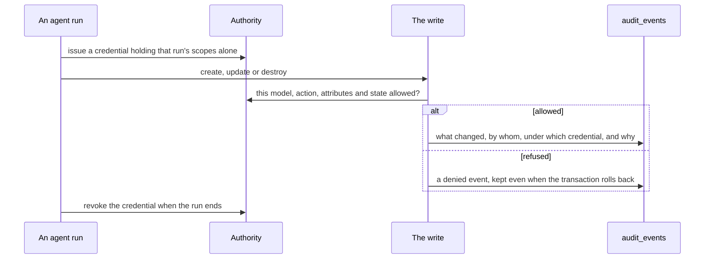
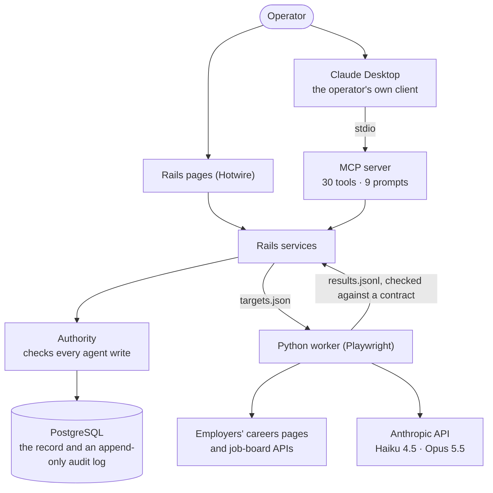

# Provenance Pipeline

[](https://github.com/ZPAlexis/provenance-pipeline/actions/workflows/ci.yml)
[](LICENSE)

**A CRM where AI agents work under permission sets and field-level security, run on my own job search: every change traceable, every decision human.**


Built by Alexis Coelho · [acoelho.dev](https://www.acoelho.dev) · [LinkedIn](https://linkedin.com/in/coelhoalexis)

AI agents do the legwork: they check at each employer's own careers page whether a role is still listed, suggest roles that fit, and score each role against the resume. The operator's own AI assistant works beside them through the MCP server: it finds and reviews companies that fit, weighs roles and recommends decisions, and what it produces is saved into the CRM as records, on the operator's word, each saying who made it and why. The CRM is the setting. The point is the governance layer most teams skip when they put agents to work:

- every agent acts under a credential scoped to the fields it may write;
- a write not allowed is refused, and the refusal is recorded;
- every change lands in an append-only audit log;
- the decisions that matter stay with the operator (human-in-the-loop), the person the CRM works for (today, me), including when their own AI assistant, Claude or another, works through the MCP server.

**Why "provenance":** every change on record says where it came from: who made it, under which permission, and why.

> **Status:** in use for my own job search, running locally. Now: a screen-risk check on each role's must-haves, and portfolio links as extended background. Next: a review of the pages, then a demo on made-up data. [Build history](docs/build-stages.md).

**Contents:** [Why I built it](#why-i-built-it) · [How it was built](#how-it-was-built) · [At a glance](#at-a-glance) · [GTM mapping](#how-this-maps-to-gtm-work) · [The permission model](#the-permission-model) · [Measured results](#measured-results) · [How it works](#how-it-works) · [The first agent](#the-first-agent-verifying-roles-at-the-source) · [Design principles](#design-principles) · [Build stages](#build-stages) · [Stack](#stack) · [Quickstart](#quickstart) · [Tests](#tests) · [Documentation](#documentation) · [Note on data](#note-on-data)

## Why I built it

> "A company I spoke with wanted to build its own CRM for AI agents to work from. From my Salesforce rollouts, I knew the hard part wouldn't be the build: it would be the governance over what agents are allowed to touch. So I built one, and I use it for my own job search."

## How it was built

> "I set the scope, the architecture and every design decision. AI wrote most of the code under my direction and review, and I verified it: tests on every step, rehearsals on my real data, and accuracy measured against labelled data, with every disagreement checked by hand. I built the first MCP server and client myself, from raw JSON-RPC, and the production server grew from them."

## At a glance

| | |
|---|---|
| **Agents** | 6 agents, plus the review queue's system grant: 17 permission types in all, and 8 decisions only the operator can make |
| **AI** | Claude through the Anthropic API: Haiku 4.5 reads pages, settles near-miss matches and weighs fit; Opus 5.5 writes drafts and resume reviews. Structured outputs, each prompt versioned, each call's cost on the record |
| **MCP** | A server of 30 tools and 9 prompts, through which the operator's AI assistant reads the record and saves its work, under a credential for each call. Any MCP client should work; only Claude Desktop has been tested |
| **Governance** | Permission sets and field-level security for AI agents: a credential per run, checked at every write down to the fields it sets; refused writes on the record; an append-only audit log, enforced by the database |
| **Data** | Careers pages read in a real browser, robots.txt honored; five job boards read through their own feeds (Greenhouse, Lever, Ashby, Workday, Oracle Cloud) |
| **Measured** | 58 of 59 verdicts right on fresh reads, and every role reported closed was closed (12 of 12); 87% of hidden careers pages found again ([AI evaluation](#measured-results)) |
| **Quality** | 883 RSpec examples and 340 worker tests; RuboCop, Brakeman, bundler-audit and ruff; CI on every push |
| **Stack** | Ruby on Rails 8.1, PostgreSQL 16, Python 3.13, the Claude API, MCP ([in full](#stack)) |

## How this maps to GTM work

The job search is the test bed; the patterns are the ones a RevOps or GTM team builds into its CRM. Nothing here connects to Salesforce, HubSpot or a sequencing tool: these are the same patterns, built from scratch.

| In a revenue team | In Provenance Pipeline | See |
|---|---|---|
| An account and its contacts | A company and its contacts, linked to its applications | [Schema](docs/schema.md) |
| An opportunity, moved through pipeline stages | An application, moved through stages by the operator alone, each change dated | [Schema](docs/schema.md) |
| Target account list | The watch list: companies chosen by judgment, never a crawl, and re-checked for months | [Sourcing](docs/sourcing.md) |
| Enrichment imports | Clay CSV exports, each field written kept as a before-and-after diff in the audit log | [Schema](docs/schema.md) |
| Waterfall enrichment | A company's careers page found cheapest and most certain step first (the page on record, common paths, homepage links, a guessed job board its vendor confirms, an LLM pick last), each find with a confidence; a low one waits for a person | [87% found again](#measured-results) |
| Enrichment and verification at the source | Checking a role at the employer's own careers page or job board: a hiring signal read at its source, never an aggregator's copy, and "closed" only when the whole list was read | [12 of 12](#measured-results) |
| ICP and account scoring | Each company scored 0 to 100 against the operator's company preferences (stage, size, business model, industries, what they want and avoid), point by point with its sources; one that does what they avoid is capped at 49 | [The `company_fit` rules](workers/verifier/src/verifier/writing_rules.md#company_fit) |
| Lead scoring, with reasons | Each role scored 0 to 100 against the resume, with its matches by line and its gaps, read two ways: as an ATS would read the resume, and with the operator's background beside it | [Fit scores](docs/agents.md#fit-scores), [the `fit` rules](workers/verifier/src/verifier/writing_rules.md#fit) |
| Unit economics per enriched record | A cost per page read, gated behind cheap checks: free job-board feeds first, an unchanged page reuses its last read, every model call's cost on the record | [137 companies for $1.17](#measured-results) |
| Funnel analytics | Stage conversion and days in each stage, from dated stage changes; how long roles stay listed; AI cost by purpose; raw SQL over the record | The Analytics page, `analytics:report` |
| Permission sets and field-level security, for AI agents | Each agent's credential, scoped down to the field and checked at every write; stage moves are the operator's alone | [The permission model](#the-permission-model) |
| Data you can trust: every change traceable to who made it and why | The append-only audit log, enforced by the database | [The permission model](docs/governance.md) |
| How to roll AI out to a GTM team safely | Autonomy earned per kind of decision, on measured agreement: agents recommend, the operator decides, and no kind acts on its own yet | [9 of 11 agreed](#measured-results) |

## The permission model

**This is the part that matters.** Each agent works under its own permission set, with field-level security: it may write only what its scopes allow, down to the fields a write sets.

| Agent | May write | Never |
|---|---|---|
| Verifier | A company's careers page, how it was found and its free board (`companies:enrich`); verdicts on roles (`postings:verify`); the evidence: page checks, LLM calls, descriptions, and the pages the operator's links show (`evidence:write`) | Track or archive a role or a company, name a company or set its kind, decide a review item |
| Suggester | Roles proposed at companies the operator tracks, while they are still suggestions (`postings:suggest`) | Track or archive anything, or touch a role the operator decided on |
| Clay importer | The seed data (`companies:import`, `postings:import`) | Set tracking or a company's proposal, or rename a company on record |
| Review queue (a system grant) | Raise, restate and close what resolved (`review:keep`) | Decide an item |
| Draft agent | A new draft or resume review as it wrote it (`drafts:write`, `resume_reviews:write`, one per run) | Edit or approve a draft, delete a review, send anything |
| Fit scorer | A role's fit score (`fit:write`): each role scored 0 to 100 against the resume, with its matches by line, its gaps and why, by the [`fit` rules](workers/verifier/src/verifier/writing_rules.md#fit), and the Background fit beside it, by [`background_fit`](workers/verifier/src/verifier/writing_rules.md#background_fit); and the LLM call that weighed it | Touch a role, change a score, send anything |
| AI assistant (the operator's own, Claude or another, through MCP) | Only the scopes of the save tool it calls, a credential per call: drafts and reviews, contacts and activities, role and company proposals, fit scores and company reviews, recommendations on the review queue; and, on the operator's word with their reason, the watch list and the company preferences | Change the watch list on its own judgment; set a verdict, or a company's name, careers page or kind; decide a review item; edit, approve or delete what it saved; move a stage; send anything |
| **No agent** | Starting an application or moving it between stages; editing or approving a draft; deciding a review item; editing the search profile, the resume, or the background and its links (the company preferences aside, on the operator's word); naming a company; deleting a contact; issuing or revoking a credential; asking for a check that writes a verdict or spends API credit | **Human-only by design** |

The last row is the point: the most consequential write is withheld from every agent. It is the code's own list (`Authority::HUMAN_ONLY`), shown on the Agents page.



- **A credential per run,** with exactly that run's scopes, revoked when the run ends and expiring anyway after 4 hours (a batch) or 1 hour (one check). Only a SHA-256 digest of its token is stored.
- **Checked where the write happens,** at the model layer, for every create, update and destroy. The credential is read again at each write, so revoking it stops its run at the next one.
- **Refusals are on the record,** as `denied` audit events, and every agent write names its credential.
- **The audit log is append-only,** in the database itself: a trigger refuses any update, delete or truncate, so a write that slips past the app is refused as well.
- **MCP reads are read-only by construction,** each inside a read-only transaction, and the record's text comes back fenced as data, never instructions. Viewing a page writes nothing.

Every scope in full, and every rule: [the permission model](docs/governance.md).

## Measured results

*AI evaluation: the agents measured against labelled data, against the operator's own decisions, and against what they cost.*

Measured on the operator's real target list, which stays out of the repo; the tests that produce them run locally ([Tests](#tests)).

- **Verdicts (2026-10-02):** on fresh reads of 59 roles with research labels, 58 were called right: 54 as labelled, and 4 where hand checks showed the label wrong. The one miss was a live role left as couldn't confirm. Every role it reported closed was closed: 12 of 12. When it couldn't read the whole list, it gave no answer (15 roles) instead of guessing.
- **Roles no longer listed:** of the 192 roles checked at the employer's own page between 2026-10-02 and 2026-11-03, 38 were no longer listed, about 1 in 5: 31 already gone at their first check, and 7 closed while being watched.
- **Finding careers pages (2026-09-30):** the known pages of 71 labelled companies were hidden and found again: 59 of 68 measured correct (87%), none wrong at high or medium confidence.
- **Recommendations against decisions (as of 2026-11-16):** the AI assistant made 11 recommendations, and 9 matched the operator's decision, measured per kind of decision. Of 89 questions, the operator decided 87 and 2 settled themselves. No kind has been granted autonomy.
- **Cost (2026-10-14):** 137 companies checked in about 47 minutes for $1.17. Since the cost pass, a check pays the AI to read a page only when its role links changed or its last full read is more than 14 days old, and a free job board is read in its place when it lists the same roles. Checks run when the operator asks: there is no schedule yet.
- **Traceability (as of 2026-11-16):** 1,840 recorded changes, in an audit log that is append-only in the database. None was refused in real use; refusals are proven in the tests.
- **Prompts, before they ship:** the agents' prompts were smoke-tested against the API on made-up records. At 4c, that caught the fit scorer citing resume lines for role preferences only the background states, fixed before it shipped.

## How it works



**A watch list, not a search.** The system watches a chosen set of companies and reports what changed. Deciding which companies are worth watching is a judgment call, left to a person; their AI assistant may propose, and they decide. Checking whether those companies opened or closed a role is mechanical, so the system does it. Roles at companies outside the list are missed, on purpose: it is built for precision and fit, not recall. [More on sourcing](docs/sourcing.md).

- **Watching.** The verifier finds each watched company's careers page, reads it in full, and records whether each tracked role is still listed. A repeat run pays the AI only for pages whose roles may have changed.
- **Finding.** The suggester proposes the roles on watched pages that fit a search profile, at no AI cost. The operator's AI assistant finds roles by meaning, and companies that fit what the operator wants of one, each researched and scored. Only the operator decides what is watched.
- **The pipeline.** An application per role, moved through its stages by the operator alone. What the agents and the operator's AI assistant produce for it (the role's fit, a resume review, its contacts and what happened, the materials written for it) is saved on it as records, each naming who wrote it. Nothing is ever sent.
- **Fit, read two ways.** Each role is scored from the resume alone, as a recruiter's screening system would read it, and again with the background the operator keeps beside it. Each kind of writing sees only the part of that background it may use.
- **Governance.** Every agent write is checked against a credential issued for its run, and refused on the record when no scope allows it. Every change lands in an append-only audit log that can be searched. What agents can't settle waits in a review queue, where the AI assistant recommends and the operator decides.

**The worker never touches the database.** Rails writes a targets file, runs the Python worker, validates every result against a fixed contract, and records it through one audited write path, under a credential issued for that run alone. How a page is read, a careers page found and a role verified: [the worker's README](workers/verifier/README.md).

## The first agent: verifying roles at the source

The first agent in the system is a **job finder**: it watches a curated set of companies (see [Sourcing](docs/sourcing.md)). Its job is verification: checking, at each employer's own applicant tracking system, which postings are actually still open. Job aggregators scrape listing URLs but never check the employer's careers page, so they cannot distinguish a live posting from a filled one. Both failure directions are real:

| Observed | Aggregator said | Employer's ATS said |
|---|---|---|
| Case A | 5 months old, presumed stale | **Live**, accepting applications |
| Case B | Listed and current | **"Job not found"** |

How fast this data goes stale, from the record: of the 192 roles checked at the employer's own page between 2026-10-02 and 2026-11-03, 38 were no longer listed, about 1 in 5: 31 already gone at their first check, and 7 closed while being watched.

### Why it can't just be an HTTP request

Most applicant tracking systems — Greenhouse, Lever, Ashby, Workable — render listings client-side. An HTTP fetch receives an empty shell.

That produces the worst available failure mode: the agent *reaches* the page, so it doesn't report an access error, but sees no roles in the DOM, so it reports "not found." **A parsing failure gets reported as a confident negative**, indistinguishable downstream from a true one.

There's no pattern-match shortcut either. Measured across 20 resolved careers pages, roughly **70% were hosted on the company's own domain** rather than a recognizable ATS URL — and those frequently embed a client-side job board anyway. The vendor is often invisible from the URL while the rendering requirement stays identical.

**So the verification worker needs a headless browser, not an HTTP client.** (A hosted board's public API is the exception: when the worker recognizes one, it reads the list there, exact and free; the browser is for everything else.)

## Design principles

Seven patterns: three found while prototyping this in Clay, a commercial enrichment tool, before writing any code, three from building it against real pages and real agents, and one from making the record answerable. [In full](docs/design-principles.md).

1. **Require corroborating observables the agent can't fake.** Every read also reports `roles_listed_count`, the roles the page shows whatever matched: `not_found` beside 23 roles listed is a credible negative, beside 0 it is almost certainly a parse failure. A carefully specified output contract doesn't guarantee the agent can tell apart the states you defined.
2. **Prose reasoning beats the structured verdict.** The free-text evidence was read every time to interpret the enum. A structured verdict is a lossy compression of a judgment, so `audit_events.reasoning` is where the fidelity lives.
3. **Gate expensive operations behind cheap ones.** Deterministic checks first (does the URL resolve? has the page changed?), model calls only on what survives. In the Clay prototype, the AI research step cost ~25x the standard enrichment columns combined.
4. **A negative needs the whole list.** A role is marked closed only when every role the page lists was read: through the ATS's own API to the end, or up to the total the page states. Anything less is inconclusive and writes no verdict, a rule enforced by the worker and again at the write path.
5. **What the agent isn't sure of goes to a person, and the person's call is on the record too.** A low-confidence find waits as a candidate, and every decision the operator makes is audited under their own identity, with their reason. An agent may recommend a decision, never make it; agreement is measured per kind, the only ground on which a kind would ever act on its own.
6. **A permission is checked where the write happens, not where the agent starts.** A scope table that nothing enforces describes intent, so the check sits at the model layer, where every write passes, down to the attributes it sets. A write some future code path forgets to check is still caught, and refused on the record.
7. **Every figure is worked out from the record, never kept beside it.** Days in a stage come from the operator's dated stage changes, how long a role stayed listed from the checks' own times, and AI cost from each call as it was made. A rate with fewer than five to go on says so rather than showing a percentage.

## Build stages

Built in stages, each decided, built step by step, and recorded as built. [Every stage in full](docs/build-stages.md).

| Stage | What it added | Complete |
|---|---|---|
| 1 — Job Finder | Careers pages found and read in full, roles matched and verified; scoped writes and provenance; checks on demand; capture by link, suggestions from a search profile, and the review queue | 2026-10-14 |
| 2 — Pipeline system | Applications moved by the operator alone; role descriptions and the resume; the draft agent; the MCP server; contacts; fit scoring; the review agent | 2026-10-27 |
| 3 — Governance completion | The audit log, searchable; analytics in raw SQL | 2026-10-29 |
| Review pass | Dependencies brought up to date, record text fenced as data, private text kept out of the logs, the audit log's trigger, no page view that writes; private data removed from the git history, and a guard now blocks it | 2026-11-03 |
| 4a — Curating the watch list | Companies tracked or archived as roles are; the operator's AI assistant curates them through [MCP](docs/mcp.md), on their word | 2026-11-05 |
| 4b — Finding companies | Company proposals and company reviews from the operator's AI assistant through [MCP](docs/mcp.md), against company preferences kept on the profile | 2026-11-10 |
| 4c — Background, and fit read two ways | A background in three parts, each read only by what may use it; the ATS fit and the Background fit, through [MCP](docs/mcp.md) first, then in the app's own agents | 2026-11-12 |
| 4d — Screen risk, and your links | Each role's must-haves read one by one, a missing one capping the fit; the operator's portfolio links as extended background | under way |
| Next | 4e, a review of the pages' experience; 4f, a demo on made-up data | |

## Stack

- **Rails 8.1 / Ruby 3.4.8 / PostgreSQL 16** — core application and system of record
- **solid_queue** — for a schedule, once there is a host; until then the verifier runs on demand
- **Hotwire (Turbo, Stimulus) and importmap** — the operator's pages, plain Rails views with no build step
- **Python + Playwright** — agent workers (managed with uv). Required rather than preferred: the verification step needs headless rendering plus LLM tooling, and both are strongest there.
- **Claude, through the Anthropic API** — Haiku 4.5 reads pages, decides near-miss matches, and weighs fit; Opus 5.5 writes drafts and resume reviews. The key stays outside the repo and reaches the worker process alone.
- **MCP, through the Ruby SDK (gem `mcp`)** — the server the operator's AI assistant connects to (any MCP client should work; only Claude Desktop has been tested)
- **fx** — database functions and triggers in migrations and `schema.rb`, so the audit log's append-only trigger is rebuilt wherever the schema loads (the test database, CI, a fresh setup)
- **RSpec, RuboCop, Brakeman, bundler-audit**; ruff and pytest for the worker

## Quickstart

It needs Ruby 3.4.8, PostgreSQL 16, and Python 3.13 with uv; it was built in WSL (Ubuntu), with the Ruby from mise.

```bash
bundle install
bin/rails db:create db:migrate
(cd workers/verifier && uv sync && uv run playwright install chromium)
bin/rails server    # http://localhost:3000
```

The AI steps read a key kept outside the repo, in `~/.config/provenance-pipeline/anthropic.env` (one line: `ANTHROPIC_API_KEY=...`), handed to the worker process alone. Without it, what needs no model still works (job-board feeds, suggestions, descriptions, the pages), and through MCP the operator's own AI assistant does the model's work, on their own subscription.

There is no demo data yet: the record is built from the operator's own target list, imported or added by link, and kept out of the repo. A made-up dataset comes with the demo. Every command, the import, backups and the pages: [Running it](docs/operating.md). Connecting an AI assistant: [the MCP server](docs/mcp.md).

## Tests

`bin/ci` runs everything the project is held to, locally: RuboCop, the gem and importmap audits, Brakeman, the privacy check, RSpec (`bundle exec rspec`), and the worker's lint and tests (`uv run ruff check .`, `uv run pytest`). GitHub's workflow runs the same on every push, the privacy check aside, which needs the record. No test calls the AI.

The accuracy tests behind the measured figures (1.2b, 1.2c) run locally against the private target list, so they aren't part of CI: `verifier:test_resolution` (hide each labelled company's known careers page and find it again), `verifier:test_a` (can the renderer extract listings at all: every careers page with a recorded roles count read, its count within 25% or 3 of the recorded one), and `verifier:test_b` (verify the labelled roles end to end: `REPLAY=1` replays each company's latest verification run, whole, with the worker's own answer to whether it read the whole list, at no API cost (runs from 1.4 on); `FRESH=1` reads the pages now).

## Documentation

| Document | File | What it covers |
|---|---|---|
| [Sourcing](docs/sourcing.md) | `docs/sourcing.md` | The watch list, its three inputs, and the tradeoff |
| [The permission model](docs/governance.md) | `docs/governance.md` | Every agent's scopes, and how they are enforced |
| [Design principles](docs/design-principles.md) | `docs/design-principles.md` | The seven principles in full |
| [Schema](docs/schema.md) | `docs/schema.md` | The tables, the choices behind them, and the verification fields |
| [The agents' work](docs/agents.md) | `docs/agents.md` | Suggestions, drafts and resume reviews, fit scores, the review queue |
| [The MCP server](docs/mcp.md) | `docs/mcp.md` | Its tools and prompts, and using it from Claude Desktop |
| [Running it](docs/operating.md) | `docs/operating.md` | Setup in full, every command, backups, the pages, and how private data is kept out |
| [Build stages](docs/build-stages.md) | `docs/build-stages.md` | Every stage as built, and what comes next |
| [The worker](workers/verifier/README.md) | `workers/verifier/README.md` | How a page is read, a careers page found, and a role verified |
| [The writing rules](workers/verifier/src/verifier/writing_rules.md) | `workers/verifier/src/verifier/writing_rules.md` | What every drafter and scorer must follow, shared by the app and the MCP prompts |

## Note on data

Nothing private is in the repo. The target list, the record and its backups, and the agents' run files stay on the operator's machine; a run file that quotes the resume is deleted as soon as its results are read, and the logs filter out the record's private text. No company on the record is named in the repo or its history: examples use made-up names, and `bin/rails privacy:names`, which local CI runs before every push, checks every file and unpushed commit against the record. [The details](docs/operating.md#note-on-data).
